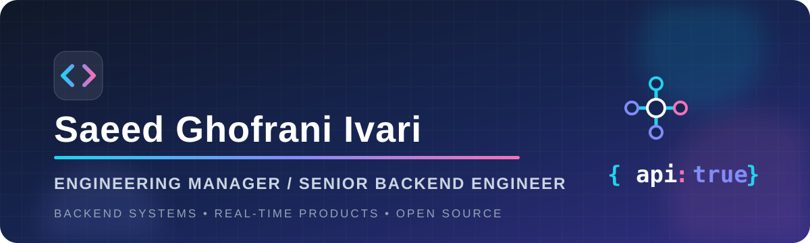
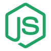

  

<h1 align="center">Saeed Ghofrani Ivari</h1>

<h3 align="center">Engineering Manager / Senior Backend Engineer</h3>

  

  Adana, Turkey &nbsp;·&nbsp; Open to international and remote opportunities

  I build and operate backend systems for commerce, trading, payments, operator workflows, and real-time products. 
  My work spans architecture, implementation, code review, database performance, incident response, delivery, and engineering leadership.

  
  &nbsp;&nbsp;&nbsp;&nbsp;
  
  &nbsp;&nbsp;&nbsp;&nbsp;
  
  &nbsp;&nbsp;&nbsp;&nbsp;
  

  <a href="https://saeedghofrani.github.io"><strong>Portfolio</strong></a>
  &nbsp;|&nbsp;
  <a href="https://saeedghofrani.github.io/resume.pdf"><strong>Resume</strong></a>
  &nbsp;|&nbsp;
  <a href="https://saeedghofrani.github.io/projects"><strong>Projects</strong></a>
  &nbsp;|&nbsp;
  <a href="https://saeedghofrani.github.io/case-studies"><strong>Case Studies</strong></a>
  &nbsp;|&nbsp;
  <a href="https://saeedghofrani.github.io/architecture"><strong>Architecture</strong></a>

---

## Resumes

Two-page resumes tailored to the role.

- [Senior Backend Engineer](https://saeedghofrani.github.io/resume-senior-backend-engineer.pdf)
- [Engineering Manager](https://saeedghofrani.github.io/resume-engineering-manager.pdf)

## Personal projects

- **[Mathematical Game Lab](https://saeedghofrani.github.io/projects/mathematical-game-lab)** — three Godot prototypes driven by Bayesian inference, timed routes, and computational geometry. C#, GDScript, and private source.
- **[Cat Keyboard](https://saeedghofrani.github.io/projects/cat-keyboard)** — a native Windows keyboard guard with manual locking, tray controls, and emergency unlock. C#/.NET; private source.
- **[Together Meet](https://saeedghofrani.github.io/projects/together-meet)** — two-person WebRTC calls, chat, and device diagnostics. Public web/signaling code; newer Android work remains private and needs real-device ringing verification.

- **[Zyzy](https://saeedghofrani.github.io/projects/zyzy-accounting-storefront)** — a storefront and accounting product, with a closer look at historical order costs and financial reporting. Private personal source.
- **[Parnia Art Studio](https://saeedghofrani.github.io/projects/parnia-art-studio)** — a Python bitmap-art studio for Persian text, image conversion, and animation. [Public source](https://github.com/saeedghofrani/parnia).

The [project directory](https://saeedghofrani.github.io/projects) also covers Quit Together, Story Platform, network-anomaly experiments, LAN file transfer, and backend tools. Each story distinguishes shipped work, prototypes, and source availability.

## Client and team work

- **[LicenseMarket](https://saeedghofrani.github.io/case-studies/license-market-backend-architecture)** — backend development and leadership of eight engineers; delivery planning, database performance, transaction workflows, and production reliability.
- **[GBT Market](https://saeedghofrani.github.io/case-studies/gbt-market-trading-payment-systems)** and **[Keyvangold](https://saeedghofrani.github.io/case-studies/keyvangold-gold-trading)** — two separate, ongoing freelance trading-platform engagements. The GBT story also covers its production chart applications.
- **[Mobasher](https://saeedghofrani.github.io/case-studies/mobasher-realtime-consulting-platform)** — NestJS microservices for consulting, messaging, and voice/video sessions.
- **[PhysioMaster](https://saeedghofrani.github.io/case-studies/physiomaster-product-delivery)** — shared work across the backend and user/admin applications, alongside team, task, and meeting coordination.

[All case studies](https://saeedghofrani.github.io/case-studies) include Symorgh ERP, Synergy, and collaborative True Dapp work. Client and employer repositories remain private.

## Public code

### [compare-guard](https://github.com/saeedghofrani/compare-guard)

**Public open source · TypeScript library**

Zero-dependency comparisons for nullable object paths, deep equality, validation helpers, and defensive property access.

### [devotell-dtai](https://github.com/saeedghofrani/devotell-dtai)

**Public integration project · NestJS / PostgreSQL**

Normalize two job-provider payloads into shared entities, with TypeORM persistence, migrations, Docker, and health checks.

### [WebRTC client](https://github.com/saeedghofrani/Webrtc-Client-React) and [server](https://github.com/saeedghofrani/webrtc-server)

**Public demo · React / Socket.IO**

Two-person calling, signaling, room state, and chat. [Try the meeting room](https://meet.saeedghofrani.xyz).

### [rust-signalforge](https://github.com/saeedghofrani/rust-signalforge)

**Public open source · Rust / Axum learning project**

Typed routes, separate domain logic, structured logging, health endpoints, and HTTP integration tests.

The [Portfolio Platform](https://saeedghofrani.github.io/architecture) is also deployed: its Next.js/NestJS/PostgreSQL source remains private, with public architecture and case studies.

  <a href="https://github.com/saeedghofrani?tab=repositories"><strong>Browse the complete public repository archive →</strong></a>

## Production experience

| Signal | Evidence |
| --- | --- |
| **Engineering leadership** | Began managing engineers in early 2024; now lead eight backend engineers at LicenseMarket, with hiring, one-to-ones, performance reviews, mentoring and delivery planning. Coordinated 5+ major releases. |
| **Reliability** | Maintained 99.9% LicenseMarket platform uptime over approximately six months, tracked with UptimeRobot and CRM incident records. |
| **Performance** | Reduced average API latency by 40% through caching, indexing and query optimization, validated with database/API timing tests over approximately six months. |
| **Real-time scale** | Supported 500+ concurrent users in production at Mobasher, with observed messaging latency of 100–150 ms. |
| **Financial systems** | Built trading, pricing, wallet, transaction, payment, KYC/AML, and verification workflows. |
| **Enterprise systems** | Contributed to the Symorgh ERP platform using ASP.NET Core, Entity Framework Core, MySQL, and Angular. |

Client and employer source code remains private. The portfolio case studies describe the work without exposing confidential implementation details.

Production figures are my reported results from private company records. Mobasher’s latency figure measures messaging, not voice or video.

Ongoing freelance work includes GBT Market and Keyvangold, two separate trading-platform engagements started in 2025.

## Tools I reach for

  
  
  
  
  
  

**Core:** TypeScript, Node.js, NestJS, PostgreSQL, MongoDB, Redis, RabbitMQ, Prisma, TypeORM.

**Real-time and operations:** Socket.IO, WebRTC, Docker, Kubernetes, Grafana, Nginx, Linux, Bash, PowerShell, CI/CD.

**Personal projects:** Rust/Axum APIs, Go applications, Godot simulations, and native C# utilities.

## Engineering principles

Build predictable APIs, make data ownership explicit, keep background work observable, and define how real-time features recover from failure. I value clear documentation and code the next engineer can debug.

## Live Projects

- [**Portfolio Playground**](https://saeedghofrani.github.io/playground): try browser demonstrations; each explains its scope and source availability.
- [**WebRTC meeting room**](https://meet.saeedghofrani.xyz): open the same room on two devices. Client and server source are public.
- [**Quit Together**](https://smoke.saeedghofrani.xyz): a private Go product with a public landing page; an account is required to explore it.
- [**Story Platform**](https://story.saeedghofrani.xyz): a public reading interface backed by a private personal repository.

## Start a conversation

For senior backend, backend lead and engineering manager opportunities, read the [recruiter brief](https://saeedghofrani.github.io/recruiters), choose a [role-specific resume](#resumes), or [email me](mailto:sa.ghofraniivari@gmail.com).

More about the workshop

I build small open-source tools, explore real-time infrastructure, and turn recurring backend problems into reusable utilities and engineering notes. Historical exercises and experiments remain in the complete public archive; they are not all production systems.

